<!-- Header banner -->

<!-- Typing animation -->

  

  

---

## 🧑‍💻 About Me

- 🎓 B.Tech student in **Cyber Security & IoT** at Asansol Engineering College
- 💻 Passionate about **Python, web development and database-driven apps**
- 🤖 Interested in **Machine Learning, RAG and AI-powered tools**
- 🔐 Exploring **cybersecurity and ethical hacking**
- 🏆 Finalist in **Smart India Hackathon (college level), Promptware and Overclock**
- 🌱 Exploring open source through **GirlScript Summer of Code (GSSoC)**
- ⚡ Fun fact: I love turning real-world problems into working projects

---

## 🛠️ Tech Stack

  

  
  
  
  
  
  

---

## 📌 Featured Projects

<table>
  <tr>
    <td width="50%" valign="top">
      <h3>🏛️ Chitragupta AI</h3>
      <i>Smart India Hackathon – College-Level Finalist</i>  
      Platform that detects anomalies in public spending (MPLADS works) using Isolation Forest and Local Outlier Factor, with role-based dashboards for MPs, DMs and Auditors.  
      
      
      
      
    </td>
    <td width="50%" valign="top">
      <h3>🔗 SafeLink AI</h3>
      <i>Suspicious URL Detector</i>  
      Web app that analyzes URLs and flags potential phishing or malicious links, combining web development with real security use-cases.  
      
      
    </td>
  </tr>
  <tr>
    <td width="50%" valign="top">
      <h3>🏙️ CivicPulse</h3>
      <i>Community Needs Prioritization Platform</i>  
      Prioritizes civic issues using a weighted scoring algorithm.  
      
      
      
    </td>
    <td width="50%" valign="top">
      <h3>⛏️ IoT Mine Safety Monitoring</h3>
      <i>LoRa Hardware Team Project</i>  
      LoRa-based safety monitoring system for mining environments. Worked on hardware assembly, sensor connections and presented the architecture to judges.  
      
      
    </td>
  </tr>
</table>

---

## 🏆 Hackathons & Certifications

- 🥇 **Smart India Hackathon (SIH)** – College-Level Finalist
- 🥇 **Promptware Hackathon** – Finalist
- 🥇 **Overclock Hackathon** – Finalist
- 📜 Introduction to Cybersecurity – **Cisco**
- 📜 Introduction to Generative AI Studio – **Google Cloud** (Simplilearn SkillUp)
- 📜 Data Visualization Job Simulation – **Tata** (Forage)

---

## 📊 GitHub Stats

  

---

## 🐍 Contribution Snake

  <picture>
    <source media="(prefers-color-scheme: dark)" srcset="https://raw.githubusercontent.com/sohaAec123/sohaAec123/output/github-contribution-grid-snake-dark.svg" />
    <source media="(prefers-color-scheme: light)" srcset="https://raw.githubusercontent.com/sohaAec123/sohaAec123/output/github-contribution-grid-snake.svg" />
    
  </picture>

---

## 🤝 Let's Connect

  
  

  

